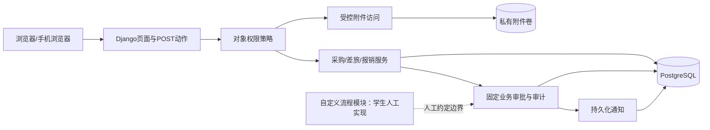
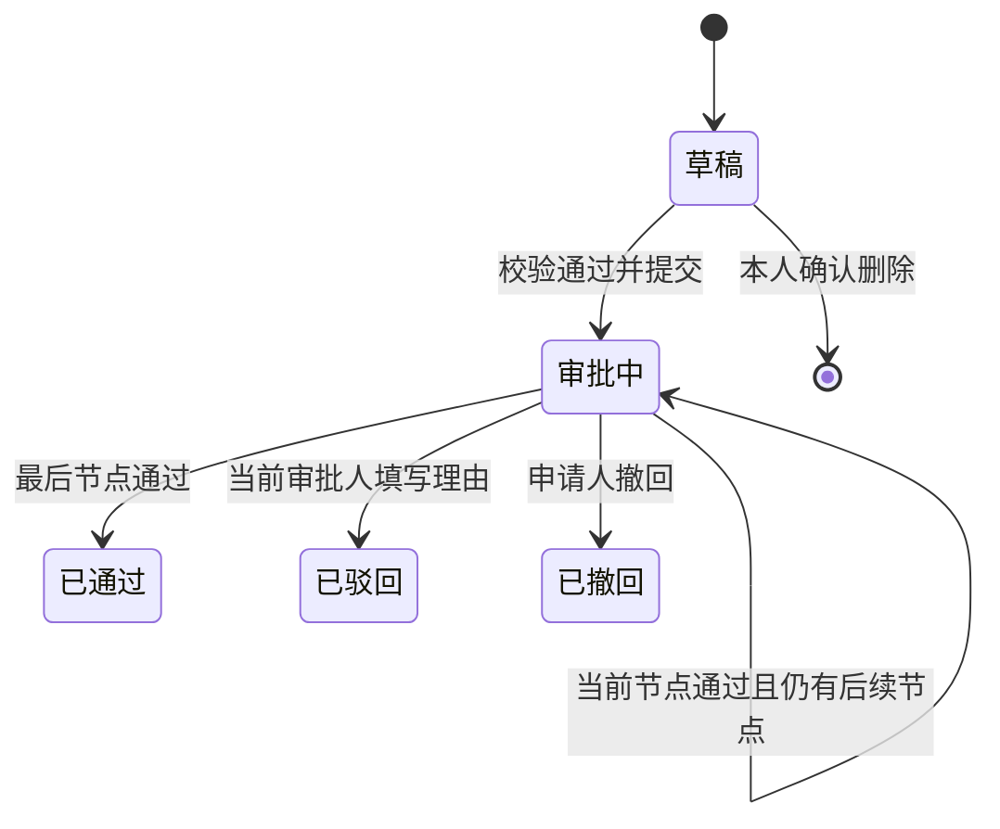

# 企业审批系统中期设计文档

课程：《BS 体系软件设计》；设计日期：2026-11-05；版本：0.1（需求与架构设计稿）。

作者、学号、学院、专业、指导教师：提交前由学生本人填写。本稿依据仓库根目录 `assignment(2026).pdf` 全文；不声称完成最终业务系统。作业封面信息见原文第 5—6 页。

## 1. 项目目标与约束

建设一个数据库持久化的企业审批 Web 应用，涵盖采购、差旅、报销和管理员可配置的第四类流程，支持多部门、多人逐级审批、历史追踪、查询统计、附件及站内通知。交付代码、设计与使用文档、可复现 Docker 部署及功能演示视频。

设计文档截止 **2026-11-16**，占最终总评 **20%**；最终代码、实验报告、容器及演示截止 **2027-01-03 前**（原文第 4 页）。为避免“前”的边界歧义，内部计划 2027-01-02 完成打包。独立完成；自定义审批流程实现不得使用 AI 辅助编程（第 3 页），本仓库仅提供该模块需求与人工清单，不生成实现。

## 2. 需求分析与验收追踪

所有条目均为最终目标，当前完成情况见第 12 节。

|编号/原文|需求与业务规则|主要验收证据|优先级|
|---|---|---|---|
|R01 / 第1页|注册、登录、退出、个人信息；用户名邮箱唯一；密码≥8位并哈希；待确认部门及角色|合法/非法注册、重复邮箱、拒绝客户端高权限字段|必做|
|R02 / 第1—2页|研发/市场/财务部门，五类角色可兼任，数据范围独立于角色|员工、负责人、财务、企业负责人、管理员逐项越权测试|必做|
|R03 / 第1页|我的申请、待办、已办、通知及管理入口；分页筛选；草稿和操作反馈|空态/加载/校验/失败/成功与删除、撤回确认演示|必做|
|R04 / 第2页|采购多明细、预算、比价、选择理由；至少两家报价或单一来源说明|两条明细、非最低报价理由、单一来源突出展示|必做|
|R05 / 第2页|差旅起止地点时间、目的、同行、交通、预算和附件；结束≥开始、预算≥0|跨日差旅及非法时间；批准差旅可被本人报销关联|必做|
|R06 / 第2—3页|报销可增删费用明细，至少支持三条；五种费用类型；本人已批准采购/差旅或独立说明|即时合计与服务端重算一致，篡改金额无效|必做|
|R07 / 第3页|费用>0；每项票据或无票例外原因；单据内票据不重复；JPEG/PNG/PDF|有效上传、超限/伪装文件拒绝、票据权限验证|必做|
|R08 / 第3页|管理员界面配置第四类流程、字段、≥2顺序节点、两类人员规则、启停版本|人工完成配置并由员工使用，旧实例不随修改变化|必做/人工实现|
|R09 / 第3页|五态、当前人员逐级审批、禁止自审、驳回理由、撤回、新单重提关联旧单|两浏览器并发、撤回竞争、非当前节点拒绝|必做|
|R10 / 第3页|路径/规则/人员快照；不可篡改日志及授权配置留痕|修改人员阈值后旧单不变；日志可追踪|必做|
|R11 / 第3页|个人及部门统计，按权限查看数量、状态和通过金额，至少一种图表|明确时间口径与样例对账，跨部门统计拒绝|必做|
|R12 / 第3页|持久化通知、新待办/通过/驳回/撤回、未读数、已读、详情跳转、幂等|重试不重复通知、他人通知不可读写|必做|
|R13 / 第4页|迁移、幂等初始化、Git记录、Compose及完整文档视频|空库部署、服务重启数据保留、最终包可复现|必做|
|R14 / 第4页|小程序或独立App覆盖所有核心流程、票据拍摄、自动提醒及可选后台触达|真实手机和支持平台证据，拒绝推送后站内可查|提分|
|R15 / 第4页|会签、委托、催办、OCR、重复票据、流程可视化等|仅在闭环完成后选少量，有完整演示|可选|

MVP 包含全部必做，不能以第四类流程为增强项而省略。响应式 Web 是基础体验，不等同于原文指定的小程序/独立 App 提分。优先保证必做闭环；提分候选为独立移动 App 与进度提醒，能否实施在 12 月阶段评估。OCR、会签等暂不排入承诺范围。

## 3. 角色和权限设计

|角色|允许范围|限制|
|---|---|---|
|普通员工|本人申请、附件、草稿、可撤回实例|不读他人无关数据，不自审|
|部门负责人|本部门授权查询及当前分给本人的待办|部门身份不允许跨部门全查|
|财务审批人|分配的财务节点及明确授权财务统计|不自动获得其他流程数据|
|企业负责人|分配的高金额/指定节点；另行授予企业查询范围|企业查询授权与审批角色分离|
|系统管理员|组织、用户、角色、配置管理|无默认业务正文和票据权限；管理变更留痕|

采用 Django 用户/组能力承载身份与角色标签，后续增加独立的数据范围授权表与统一服务端策略。当前 Group 初始化不授予业务权限。页面入口仅辅助体验，列表、详情、统计、动作及附件每次请求都检查对象权限。未授权对象统一返回 404，避免枚举。注册只接收白名单字段；部门申请值不直接成为正式归属。申请人、正式部门、操作者和时间从会话及数据库确定。

Django 超级用户仅供开发者基础设施维护，不作为业务系统管理员账号；未来业务授权不能以 `is_superuser` 绕过。Django Admin 不注册申请正文、票据或审批日志模型，以免其默认权限形成旁路。

## 4. 技术选型

|层次|选型|理由及边界|
|---|---|---|
|语言/后端|Python 3.11 + Django 5.2 LTS|内置认证、表单、ORM、迁移、CSRF；独立开发减少集成成本|
|界面|Django Templates + 原生 CSS/JavaScript|服务端渲染，业务动作POST，局部交互及轮询；无需Node构建链|
|数据|PostgreSQL 16 + psycopg 3|事务、行锁、唯一约束用于审批一致性；SQLite仅启动与基础测试|
|部署|Docker Compose + Waitress + WhiteNoise|Windows本地与Linux容器共用WSGI服务；静态资源独立于私有附件|
|通知/文件|数据库站内通知 + 15秒轮询；受控下载与Docker卷|必做不依赖商业推送；文件不暴露公共MEDIA_URL|
|测试|Django TestCase/TransactionTestCase|权限和计算回归；并发场景必须使用PostgreSQL独立连接|

比较方案：Vue/React + REST 灵活但增加前端构建、鉴权接口及双份校验工作；Spring Boot + Vue 适合熟悉Java的开发者但此处无既有工程约束。基于单人交付期限选择 Django 单体。若后续确认个人技术偏好可复审选型。

依赖以 `requirements.in` 声明兼容范围，以实际安装的 `requirements.txt` 精确版本复现；镜像主版本固定，最终提交应进一步记录镜像digest。Django 5.2为LTS，官方支持期至2028年4月；不盲追最新主版本。

官方参考（查询日期2026-11-05）：[Django下载与支持周期](https://www.djangoproject.com/download/)、[部署清单](https://docs.djangoproject.com/en/5.2/howto/deployment/checklist/)、[事务](https://docs.djangoproject.com/en/5.2/topics/db/transactions/)、[行锁](https://docs.djangoproject.com/en/5.2/ref/models/querysets/#select-for-update)。作业需求的权威依据仍为本地原始PDF。

## 5. 总体架构与模块职责

模块划分：accounts（身份组织）、core（基础设施）、applications（申请基础及查询）、procurement/travel/reimbursement（三类业务）、approvals（固定业务流转）、attachments（上传下载）、notifications（站内消息）、audit（不可编辑记录）、reports（授权统计）。除 accounts/core 外，目前均是设计，尚未创建实现。

自定义模块独立人工完成；本文只给需求和概念实体，不规定实现算法、数据迁移或动态表单代码。人工确认对接方式前不生成集成实现。

## 6. 数据设计

金额统一使用有符号64位整数分（人民币），数量用精确小数；单项乘积按人民币分四舍五入后再合计，提交时服务端重算；预算和报价也使用分。时间存UTC、展示Asia/Shanghai。差旅时长采用本地自然日，含首尾两日，同日为1天。所有正式编号服务端生成，以数据库唯一约束保证；主键与展示编号分离。

|实体|主要数据/关系|约束及删除策略|
|---|---|---|
|Department / User / Role|用户正式部门，可多角色；部门申请与正式归属区分|用户名/邮箱大小写不敏感唯一；停用代替删除；部门被引用时PROTECT|
|DataScopeGrant|用户、范围类型、部门/企业、授权人、原因|角色不隐含数据范围；变更审计|
|Application|编号、类型、申请人、部门、标题、状态、版本、原单、提交时间、金额分|编号唯一，正式记录不硬删；草稿允许本人删除|
|Procurement / Item / Quote|采购主体、多条规格数量价格、供应商报价和选择理由|预算非负、明细有效、2家报价或单一来源原因|
|Travel|地点、起止日期时间、目的、同行、交通、预算|起止校验；批准后本人可关联|
|Reimbursement / Expense|关联原申请、费用类型日期金额、无票例外及原因|有效费用>0；跨主体关联禁止|
|Attachment / ExpenseAttachment|存储键、原名、MIME、大小、哈希、上传人时间、所属申请/费用|不以文件路径授权；同单票据记录唯一关联；日志引用保留|
|ApprovalInstance / Node|申请版本、路径规则快照、节点顺序、具体审批人、当前节点|提交后快照冻结；一个有效当前节点；不得自审|
|ApprovalRecord / AuditEvent|申请版本、节点、操作者、动作、意见、时间、结果|业务账号无更新/删除入口；配置授权变更同样记录|
|Notification|收件人、事件标识、申请、内容、已读时间|收件人+业务事件唯一；仅本人读写|
|流程模板及版本（人工模块）|覆盖名称说明、部门、字段、节点、发布版本、启停及实例关联需求|由学生独立设计实现；历史实例不受模板修改影响|

关系：部门1:N用户；用户M:N角色；用户1:N申请；申请1:N业务明细/附件/审批记录；申请版本1:1本次审批实例；实例1:N节点；业务事件1:N通知。明细中的附件通过关联实体对应票据；采购/差旅到报销使用受限外键关联。审批人与申请人需保留显示快照，账号停用后历史可查。审批历史、正式申请与附件不因用户注销级联删除；过期草稿的孤立文件可在确认未引用后清理。初始化仅创建组织与角色标签，不创建默认高权限密码。

## 7. 核心流程与一致性设计

终态仅查询；驳回或撤回后复制为新草稿，关联原单，不能回改历史。允许申请人在审批中撤回，包括已有中间节点通过的情况，撤回后所有剩余待办失效。

固定流程初始方案：采购为部门负责人→财务预算审查，金额≥10,000元再加企业负责人；差旅为部门负责人，预算≥5,000元再加财务；报销为部门负责人→财务。金额阈值是本设计假设，不是作业指定值，后续根据演示需要确认；提交时保存阈值、路径、人员及部门快照。角色必须解析为一名实际人员；无人、多人歧义、自审或部门负责人本人申请时阻止提交并提示管理员配置合法替代人，不自动跳过节点。

事务边界：提交的主体、明细、金额、审批快照、首个待办、日志、通知同事务；审批与撤回锁定同一个申请及有效节点，核对状态、操作者与版本后改变状态。并发失败返回“状态已变化，请刷新”，不部分成功。每次提交/动作携带客户端幂等键，数据库以操作者+动作键唯一约束保存结果；同键相同请求返回原结果，不同内容拒绝。另用有效节点与流转序号唯一约束兜底。通知使用事件标识+收件人去重，事务回滚时通知一并回滚。

以上为固定业务审批设计。人工模块采用何种实现由学生决定，需满足原文同等的流转、快照与并发验收标准。

## 8. 界面与路由规划

当前可用路由只有 `/`、`/health/`、`/admin/`；以下是未来设计，尚未开放。

|入口/方法|功能|授权要点|
|---|---|---|
|GET/POST /accounts/register/、login/；POST logout/|注册登录退出|注册字段白名单，密码校验，CSRF|
|GET /applications/、/applications/{id}/|筛选分页、详情与进度|先限定可见数据集再查询和统计|
|POST /applications/{id}/submit/、withdraw/|提交、撤回|本人、状态/版本校验、幂等|
|POST /applications/{id}/copy/|复制重提|本人且原单终态，生成新单|
|GET /tasks/；POST /tasks/{id}/approve/、reject/|待办与审批|当前具体人员，拒绝自审及后续节点|
|POST /attachments/；GET /attachments/{id}/download/|上传/预览/下载|拥有主体权限，草稿上传绑定本人|
|GET /notifications/；POST /notifications/{id}/read/|轮询/未读/标记|只能当前收件人；幂等|
|GET /reports/|数量、分布与通过金额|统一对象范围，不接受任意部门扩大范围|

查询参数统一 type/status/from/to/q/page；默认每页20条，最大100条，按提交时间和ID稳定排序。写操作不使用GET。403用于动作权限拒绝，409用于状态冲突，表单返回字段错误；HTML与局部JSON响应保持同一服务层校验。

页面信息架构为“工作台→我的申请/我的待办/已办→详情→附件/审批轨迹”，管理员入口与业务入口分开。表单有保存草稿、确认提交与错误定位；采购/费用多行可添加删除，手机采用卡片而非宽表格；详情突出当前审批人、单一来源和无票原因。图表先使用服务端渲染CSS柱状图，辅以数字和文本以便读屏。

## 9. 安全、附件与统计口径

登录使用同源Session与CSRF，不在浏览器存JWT；密码使用Django框架哈希。正式部署启用HTTPS、Secure Cookie与可信域；密钥从环境读入，不进入Git。登录与上传需配置速率限制；模板默认转义，外链限制HTTP/HTTPS。

附件建议单个≤10MB，每费用明细≤5个、单申请≤20个且合计≤50MB（后两项为本设计限额）。同时验证扩展名、实际文件签名、大小和类型，不仅相信Content-Type；随机存储键防止路径穿越。HTML/SVG等主动内容拒绝，PDF及图片仅经授权视图提供，下载采用attachment及nosniff；需要预览时用受限沙箱，PDF优先下载。上传后未提交文件与用户草稿绑定，禁止跨用户挪用。后续可补充恶意文件扫描，当前不宣称已有扫描能力。

统计按提交时间区间过滤；状态分布展示该区间提交的单据当前状态；“通过金额”仅汇总当前已通过且提交时间在区间内的金额，排除草稿、驳回、撤回，单位元显示但数据库按分求和。不同类型分别列示，避免采购与其报销相加误作企业实际支出。通过率=已通过/(已通过+已驳回)，分母为0显示“暂无”；所有统计复用列表的权限范围。

## 10. 测试与验收计划

|场景|预期|环境|
|---|---|---|
|注册注入管理员/部门/审批人、大小写重复账户|拒绝多余高权限字段；唯一校验和数据库约束有效|自动化集成|
|员工越权列表/正文/票据，管理员无业务授权|不泄露数据；直接改ID同样失败|五角色跨部门矩阵|
|采购2项、2报价，单一来源，非最低价无理由|合法通过/非法阻止|表单+服务端|
|差旅结束早于开始、跨日、预算负数|阻止非法；自然日计算正确|单元+页面|
|报销3项、0/负数、改总额、重复票据、无票|服务端重算；无票原因必填并突出|单元+集成|
|重复审批、双浏览器、批准与撤回竞争|仅一次有效流转，记录/待办/通知一致|PostgreSQL多连接并发|
|阈值/人员变更后查看旧单|已提交路径和人员快照不变|回归|
|重复事件及他人通知标记|只生成一次，拒绝越权|集成|
|附件10MB边界、伪装类型、跨用户下载|按规则接受或拒绝|集成|
|全新Compose、重启、再次seed、备份恢复|可启动、数据保留、无重复初始化|真实Docker|
|第四类流程完整配置与使用|由学生独立完成并留存证据|人工模块验收|

性能设计目标（非实测）：10,000份申请、20个并发演示用户下列表/详情P95<1秒（不含文件传输），列表分页、申请人/部门+提交时间及当前人员待办建立索引。只在有测量环境后报告指标，不伪造结果。

## 11. 里程碑与风险

|时间|交付和退出条件|
|---|---|
|11月5—10日|需求追踪、技术选型、基础工程和数据模型评审|
|11月11—15日|补齐个人信息、审阅设计、准备中期提交包，11月16日前提交|
|11月17—29日|账户授权、采购/差旅/报销表单与附件闭环|
|11月30日—12月13日|固定审批、日志、通知、查询统计；学生独立完成自定义模块|
|12月14—20日|权限/并发/PostgreSQL验收；有余力再决定独立App提分|
|12月21—28日|Compose全新环境部署、使用手册、测试报告、视频|
|12月29日—1月2日|修复、版本标记、导出真实Git日志、最终打包|

最高风险：人工模块时间不足，应尽早独立开发；对象权限遗漏，用角色×接口×数据归属矩阵覆盖；并发只在SQLite测试，必须安排PostgreSQL验证；移动提分范围膨胀，以必做优先；Docker引擎/镜像下载失败，提前在第二台机器复现；附件与数据库备份脱节，成套备份并恢复演练。

## 12. 本次完成状态与后续工作

本次形成需求追踪、权限边界、技术选型、概念数据模型、状态机、固定审批一致性方案、路由/页面规划、验收计划与时间安排。仓库建立Django启动骨架、用户/部门模型、迁移、基础初始化命令、首页与健康检查、Docker配置及依赖文件。

这些不等于业务已完成：注册审批、三类申请、业务授权、附件、审批引擎、审计通知与统计待开发；自定义流程实现由学生手写。当前验证结果单独记在 `docs/verification.md`；容器运行、PostgreSQL事务并发、移动App均需后续实际验收。中期提交前应由本人复核课程限制、设计可行性与所有内容，补齐个人信息，按教师要求导出提交格式。
